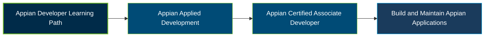

# Appian Certified Associate Developer ACD101 Certification Exam Guide

A dedicated study guide and technical reference for candidates preparing for the **Appian Certified Associate Developer (ACD101) Certification Exam**, covering Appian platform fundamentals, application design, development, and maintenance best practices.

---

## Exam Overview

The Appian Certified Associate Developer certification validates foundational knowledge of designing, developing, and maintaining applications using the Appian low-code platform.

- **Exam Format**: Online, remotely proctored examination with multiple-choice, matching, and list-building questions.
- **Target Audience**: Aspiring Appian developers, application developers, Appian partners, and technical support professionals.
- **Prerequisites**: No formal examination prerequisite is listed in the available official material. Appian recommends completing the Developer Learning Path and participating in Applied Development.

---

## Core Exam Domains & Knowledge Areas

### 1. The Appian Platform

- Understanding the Appian platform and its core capabilities.
- Identifying platform resources and development tools.
- Recognising the role of Appian design objects in application development.

### 2. General Appian Principles

- Applying Appian development principles and best practices.
- Understanding application design and development concepts.
- Following appropriate approaches to building and maintaining applications.

### 3. Data Manipulation

- Working with application data and data structures.
- Understanding data operations and manipulation in Appian.
- Applying data concepts when building application functionality.

### 4. Appian Process Modeling

- Understanding process models and workflow design.
- Working with process activities, variables, and process flows.
- Applying process modeling concepts to business requirements.

### 5. Appian Interface Design

- Understanding Appian interfaces and SAIL concepts.
- Designing user interfaces for application workflows.
- Applying interface components and design best practices.

### 6. Appian Records

- Understanding Appian records and record types.
- Working with record data and connected data sources.
- Using records to support application experiences and workflows.

### 7. Appian Expression Rules

- Understanding expression rules and their role in application logic.
- Working with Appian functions and expressions.
- Applying reusable logic and expression development practices.

---

## Certification Path

---

## Recommended Practice & Study Resources

Use Appian's official learning resources and documentation as the foundation for exam preparation, supported by practical application-building experience.

- **CertsGate**: Explore [Appian ACD101 Certified Associate Developer preparation resources](https://certsgate.com/exams/appian/acd101) for supplementary study and practice.
- **Appian Documentation**: Use the [official Appian documentation](https://docs.appian.com/) to review platform concepts, design objects, interfaces, process models, records, and expression rules.
